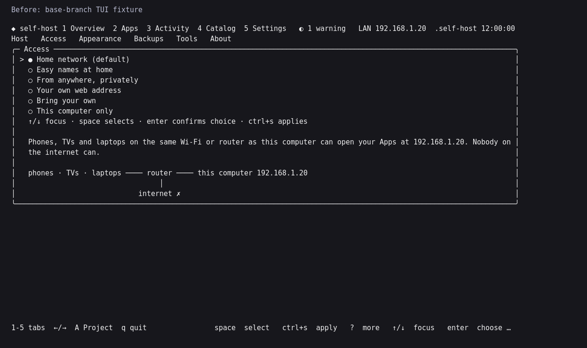
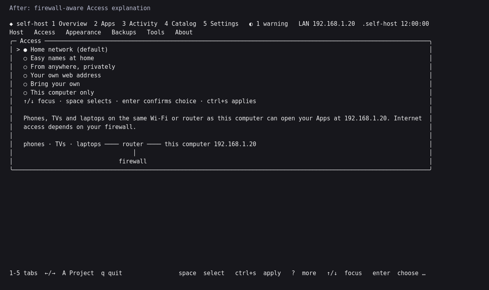

# Compose and media storage verification

Verified on 2026-11-01 against `a86aff8f` plus the review fixes accompanying
this document. Three independent reviews covered Standards, specification
correctness and platform behavior. Findings were fixed and regression-tested.

## Local checks

All passed:

- `gofmt -l .` and `git diff --check`.
- `go build ./...`, `go vet ./...`, `go vet -tags e2e ./e2e/`.
- `go test ./...`.
- `go test -race ./internal/tui ./internal/activity ./internal/project ./internal/service ./internal/compose ./internal/helpers ./internal/host`.
- `bash -n install.sh`.
- Regeneration with `go run ./tools/sitegen`, with no generated-data drift.
- The web build, tests, lint, typecheck and `test:compose` gate using Bun 1.4.3.
  Compose validated every supported export individually, all self-host Apps
  together and all supported services together.

The final binary cross-built with `CGO_ENABLED=0` for Linux and macOS, both
amd64 and arm64. The native Linux amd64 binary executed `--version`, `--help`,
`apps list --json` and `skill` with an isolated Home folder.

## Docker runtime

Host: Linux amd64, rootless Docker 29.3.0, Compose 5.1.0. Each acceptance target
used unique temporary Compose Projects, isolated storage and loopback-only
ports. Cleanup was scoped to those Projects.

The acceptance command was:

```sh
E2E_TARGETS='media ntfy vaultwarden' \
E2E_LOG_DIR=/tmp/self-host-full-review/e2e-final \
GOFLAGS=-buildvcs=false GOCACHE=/tmp/selfhost-gocache \
go test -tags e2e -run '^TestE2E$' -v -timeout 30m ./e2e/
```

The harness now selects shared media storage with `--data-root`; it observes
and cleans up canonical Projects using the private `.env`. An initial run
exposed the harness's obsolete mandatory `secrets.env` argument. That argument
was fixed, the retained temporary Project was recovered, and acceptance was
rerun from clean Projects.

| Target | Verified behavior |
| --- | --- |
| Media Recipe: Jellyfin, Prowlarr, qBittorrent, Radarr, Seerr, Sonarr | Install, Setup/checks, idempotency, restart, stop/start recovery, update, Backup, isolated Restore, restored checks and matching data sentinels. |
| ntfy | The same lifecycle, plus a real saved notification recovered from Backup. |
| Vaultwarden | Install, Setup/checks, idempotency, restart, stop/start recovery, update, Backup, isolated Restore, restored checks and matching data sentinels. |

Separate temporary probes inside Sonarr and Radarr, run as their `abc`
application user, created links from the torrent category to the library and
verified equal device/inode pairs. Probe files were removed. This establishes
hardlink capability on this storage, not that a real Arr import used a link.

Ordinary `docker compose config --services` and `docker compose ps` also found
an isolated Project from its directory without self-host, `-p` or `--env-file`.
The persisted name and service matched the running Project.

Sanitized acceptance evidence is in the local directory named above. Archives,
credentials and private logs are not committed.

## Review safeguards

Regression tests cover:

- Conflicting volumes, networks, configs and secrets shared with manual services,
  including implicit default networks: Restore refuses before replacing data.
- Include-local `.env` files: consolidation refuses before writes rather than
  dropping their interpolation scope.
- Environment-backed Compose secrets/configs, indirect interpolation inputs and
  shared assignments whose quoting changes their meaning.
- Supplementary Linux groups and existing media directory symlinks, while
  keeping separate-user configuration private.
- NSS-aware UID allocation and fresh Restore collision checks, with no automatic
  reassignment of archived file owners.
- Separate-user Restore refusal on unverified rootless, remapped or non-Linux
  destinations. Verified local rootless support is covered below.
- Scoped, application-user configuration reads for separate-user API key recovery.

## Platform limits

| System | Evidence from this run |
| --- | --- |
| Linux amd64, rootless Docker | Native tests, binary execution and Docker lifecycle acceptance above. |
| Linux arm64 | Release cross-build; native tests require its CI runner. |
| macOS amd64 and arm64 | Release cross-build; native tests require their CI runners. Docker Desktop/OrbStack storage was not exercised here. |
| WSL2 | Uses the Linux binary; no Windows/WSL2 runtime was available for this run. |
| Linux rootful, supplementary groups, user namespace remapping | Focused mocked mapping/identity tests and real local filesystem tests. A separate rootful Docker daemon was not exercised. |

The existing four-platform native CI matrix now runs the Project, Host, Compose,
Helpers and service tests as well as its binary/installer smoke checks. This
records added CI coverage, not a claim that those remote jobs ran locally.

Separate App users remain optional and off by default. Unsupported namespace
mappings require explicit ownership reconciliation. NAS permissions, separate
datasets, APFS/NTFS sharing and every Catalog App still need their own runtime
evaluation; this run does not establish those outcomes.

## Follow-up review

The direct review found and fixed two Restore defects: global Compose extensions
could lose aliases to service-defined anchors during fresh Restore, and scoped
Restore could truncate quoted multiline environment assignments. Regression
tests now cover both paths, including comments, quoting, unrelated assignments
and key-looking lines inside multiline private values.

After these fixes, the full Go suite, race checks for the affected packages and
Dashboard, build/vet, e2e vet, formatting, installer syntax and the full web gate
including Compose validation passed. The four Linux/macOS amd64/arm64 binaries
were rebuilt with CGO disabled. The Linux amd64 binary passed CLI smoke checks.

The real Docker lifecycle suite was repeated for the media Recipe, ntfy and
Vaultwarden; all three targets and their cleanup passed. Evidence is in
`/tmp/self-host-review-agent-verified`. Platform limits above still apply.
Local development archives and checksums are under `dist/review-cli/downloads/`.

## Advisory storage preflight

Doctor, the Onboarding review and approved media preparation now check the
selected torrent/category and applicable completed-Usenet/category paths against
each importing App's library. The host probe creates an empty temporary file,
links it into the library, verifies file identity and removes both entries.
It preserves existing files and does not create the selected storage folders.
Missing folders and remote Docker endpoints are reported as skipped; failures
warn, and Setup/Check still verifies capability inside the importing App as its
own user. Skipped checks are shown neutrally in Onboarding.

Focused existing Doctor, Onboarding, media and hardlink checks and static vet
passed. An isolated manual check verified real local hardlinks, cleanup after
success and missing-target failure, preservation of an existing file, both
importers' preflight paths, no Project created before approval, legacy-layout
exclusion and installed-Project Doctor wiring. Injected filesystem/endpoint
results verified cross-filesystem warnings, missing-folder reporting and remote
endpoint exclusion. All four Linux/macOS builds compiled; native platform and
App-container limits above still apply.

## Local rootless identities and address diagnostics

Separate media App users now support a verified local Linux rootless daemon.
The active Unix socket's peer identifies the daemon; its actual kernel UID/GID
maps determine host owners. New directories receive their ownership and modes
through a pinned, revalidated user namespace. Existing directories are only
validated. NSS collision checks use mapped host IDs. Additional `userns-remap`,
remote/unverified namespaces and automatic ownership migrations remain refused.
Onboarding checks capability before approval.

On this Linux amd64 host, an isolated real Compose Project with two minimal
Alpine fixtures exercised the public service install path using distinct media
App identities. Both users wrote private `0700` configuration; one wrote a
shared download and the other created a hardlink with matching device/inode.
Backup, existing-Project Restore and fresh-Project Restore preserved the
private data and container identities. Both temporary Projects and their
containers were removed. This verifies the ownership/storage mechanism, not a
new functional acceptance of every upstream media image.

The original rootless refusal reproduction now passes. Focused existing
ownership, Restore, network, Access and TUI checks passed with the race detector;
static vet and all four Linux/macOS binary builds passed. Native platform limits
above still apply.

Read-only interface inspection confirmed this host's default-route address is
public; its separate overlay address is shared/CGNAT space. The Dashboard now
classifies public, private, shared/VPN and local addresses instead of labeling
every address LAN. Doctor and Onboarding warn about all-interface publishing on
a public host. Access help explains firewall dependence, including the public
ports retained when Tailscale is added. Existing settings and binds are retained.

The before/after images below render deterministic Dashboard golden fixtures;
their example address is fixture data, not a private host observation.

| Before | After |
| --- | --- |
|  |  |

## PR review fixes

A further complete-diff review found five defects. Media HTTP fixtures used
fixed `1000:1000` owners for real temporary storage and failed on CI runners
with different IDs; they now use the executing test user's IDs, including
Seerr's ownership expectation. Legacy environment consolidation now retains raw
interpolation and declaration order, including synchronization for recovery.
Scoped Restore keeps selected assignments in archive order, preserving repeated
assignments and multiline values. Migration also retains CDI device selectors
instead of rebasing them as host device paths.

NZBGet also retained download paths invisible to the new importer layout. Its
shared layout now adds the Usenet mount and configures DestDir, InterDir and
the file-creation mask through the upstream
[configuration API](https://github.com/nzbgetcom/nzbget/blob/develop/docs/api/SAVECONFIG.md).
The previous `/downloads` mount, queue location and unrelated saved options
remain intact. Host and App-user Usenet probes now include NZBGet. RPC fixtures
verify both permission modes, idempotency and failed-restart recovery; this
focused review did not run a real NZBGet container or a Usenet download.

The new regression cases failed before the fixes and passed afterward. The
affected media App packages and the full Project, service and CLI suites passed;
focused vet, formatting and diff checks passed. No Docker runtime, browser or
installer was run for these focused fixes. An additional different-UID user
namespace probe was unavailable because this host refused its UID map; CI
provides the different-user check. The preceding PR revision passed all four
native platform jobs; its general Go job exposed the media fixture issue above.
The four initial fixes subsequently passed every job in
[CI run 41347941307](https://github.com/ajnart/self-host/actions/runs/41347941307),
including native Linux/macOS amd64/arm64. After the NZBGet follow-up, the full Go
suite, build/vet, e2e vet, generated-data check and web build/tests/lint/typecheck
passed locally; its focused storage cases also passed with the race detector.
