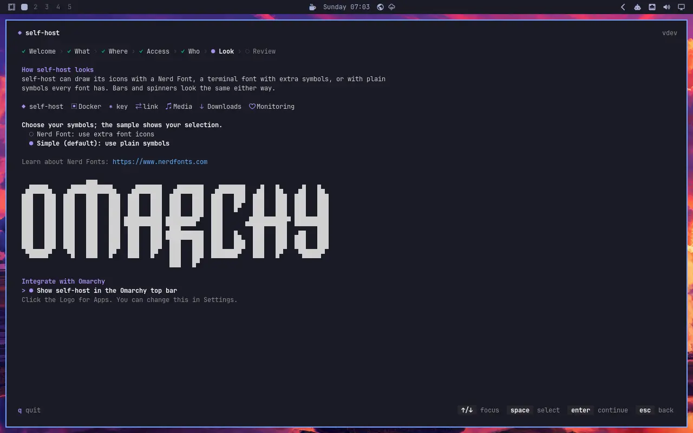
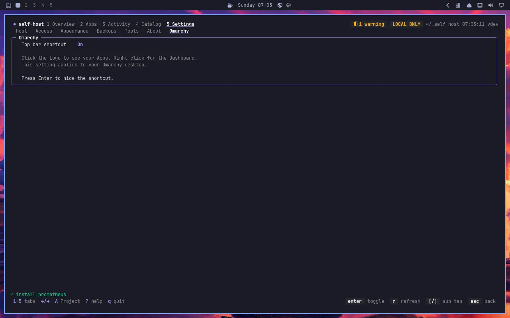
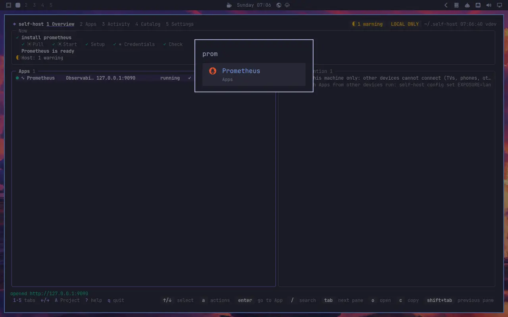
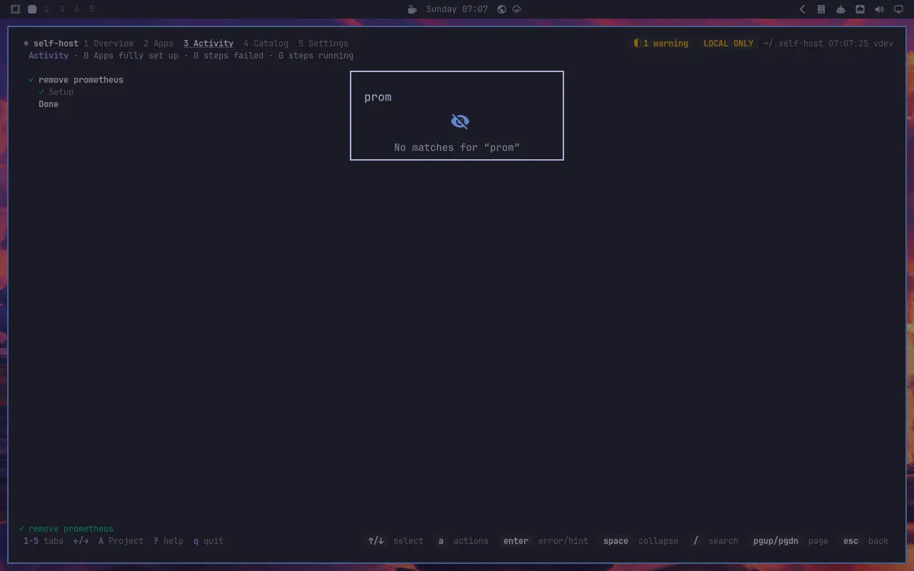
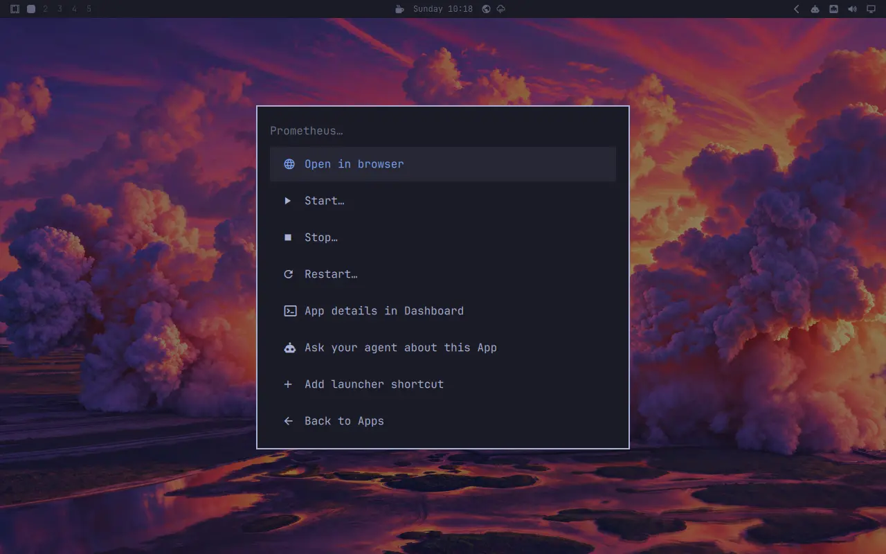
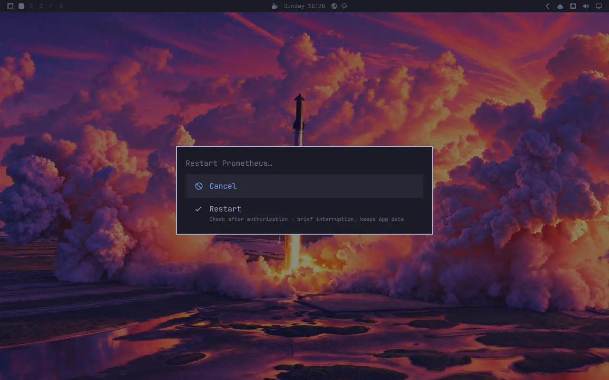
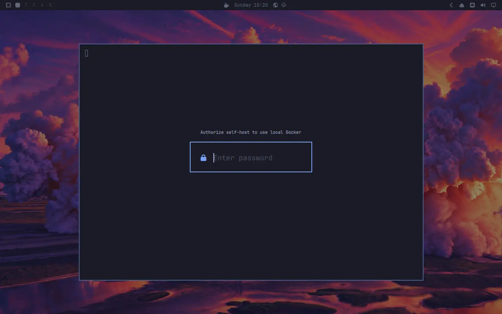
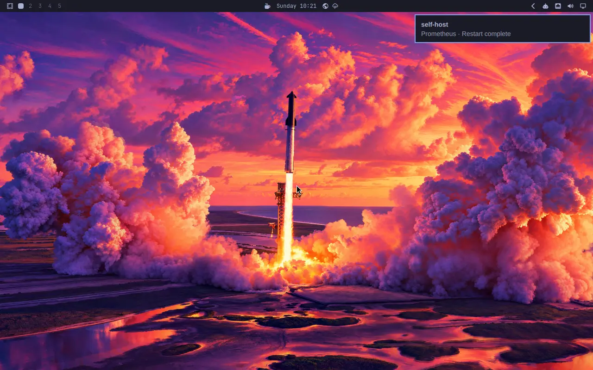

# Omarchy integration evidence

These captures come from disposable x86_64 guests on Omarchy 4.5.0-3. Pacman verified a signed lab repository for each run. The package versions below identify development builds. For the build procedure, read the [Omarchy package guide](../../../packaging/omarchy/README.md).

## Onboarding, the top bar, and App removal

Revision 11 opened the existing Onboarding from **Super + Space → Setup → Self-hosting** when the Project was absent. Cancelling Review kept the Project absent and the bar shortcut off. An approved loopback Prometheus install completed Setup, returned `up = 1`, and enabled the optional white Logo in Omarchy’s top bar.

On the next visit the same entry opened the App picker. A pinned App appeared in launcher search with its Catalog icon. Cancelling Remove preserved the pin. Dashboard Remove deleted the generated pin and kept App data. An elevated CLI Remove also cleaned the generated entry in a custom data directory and preserved an edited entry. [Revision 11 checks](receipts/onboarding.json)

| Onboarding opt-in | Dashboard setting and top bar |
| --- | --- |
|  |  |

| App pinned | After App removal |
| --- | --- |
|  |  |

## Reviewed Start, Stop, and Restart

Revision 13 used the stock local Docker socket and the user’s original groups. The picker listed the installed App with **Live Status unavailable**. Both the named review Cancel and Omarchy’s authorization Cancel preserved the running container’s start time. The approved Restart changed that timestamp. A Start against the already-running App was rejected, Stop took its endpoint offline, and Start brought Prometheus back with `up = 1`. An unrelated container kept running. [Revision 13 checks](receipts/native-actions.json) · [Floating terminal geometry](receipts/floating.json) · [Standards and spec review](reviewed-actions-review.md)

| App picker | Named review |
| --- | --- |
|  |  |

| Native authorization | Confirmation |
| --- | --- |
|  |  |

More captures for [unavailable live Status](images/final-inventory.webp), [rejected Start](images/start-rejected.webp), [successful Stop](images/stop-success.webp), and [successful Start](images/start-success.webp).

## Agent handoff

With no default agent, the App row opened Omarchy’s [default-agent picker](images/agent-picker.webp). With Codex selected, it [copied the prompt](images/agent-handoff.webp) and [opened Codex](images/agent-ready.webp). The prompt names the App ID and requests an inspection and plan before approval. The test ended at the sign-in screen. The exact clipboard text is in the [Revision 13 checks](receipts/native-actions.json).

## Upstream review

The [two-row Omarchy 4.5 menu patch](omarchy-v4.5.0-nested-menu.patch) is the proposed upstream surface. Lab signing, native authentication, and App behavior were verified on x86_64. Release asset integration, public package availability and aarch64 verification are open. See the [handoff](../omarchy-handoff.md) for the next phase.
